Week 5 Deliverables:

# Task 1:
## Verify  the nearest cities endpoint:
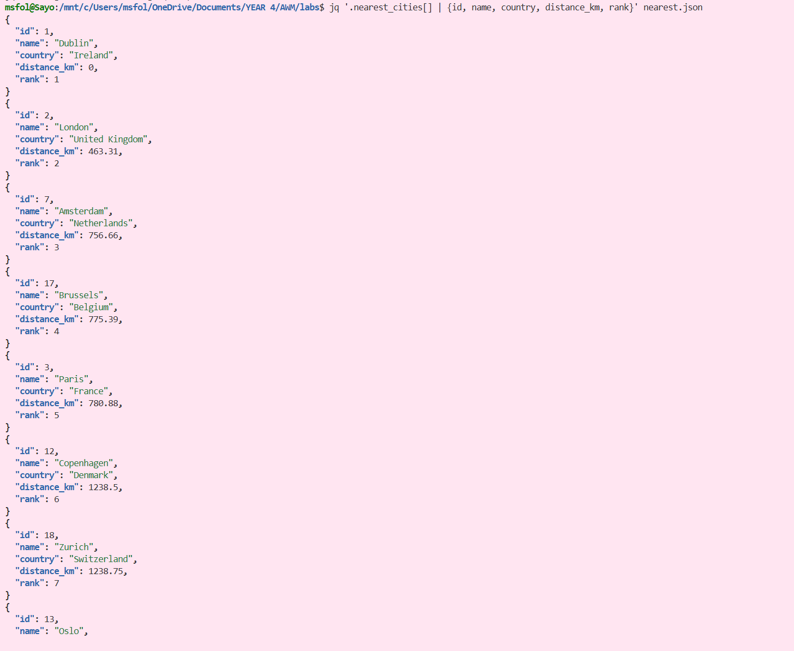

## Verify that records were returned and sorted from nearest to farthest:
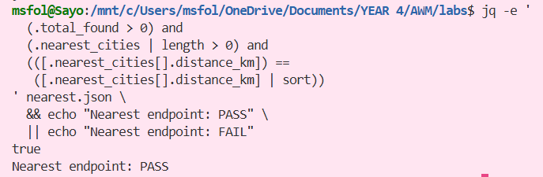

## Verify that no more than 10 nearest cities are returned:
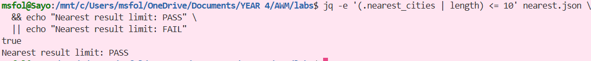

## Verify the radius endpoint:
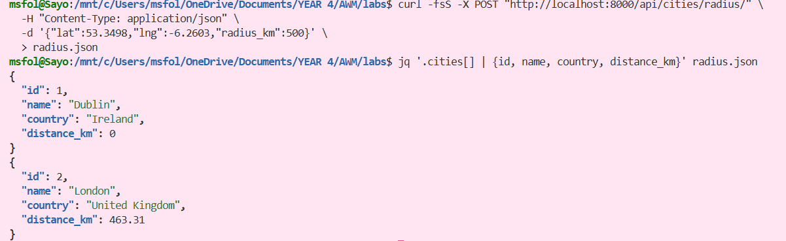

## Verify that records were returned and sorted from nearest to farthest:
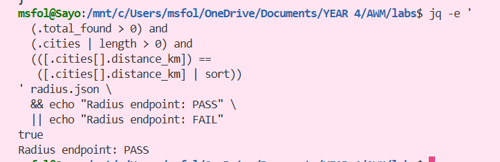

## Verify that every returned city is within the requested radius:
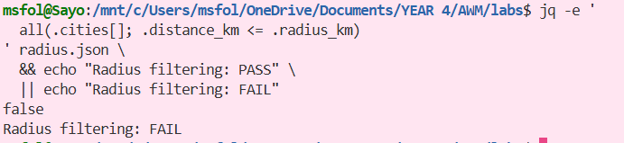

## Verify invalid input is rejected
(Missing Latitute)
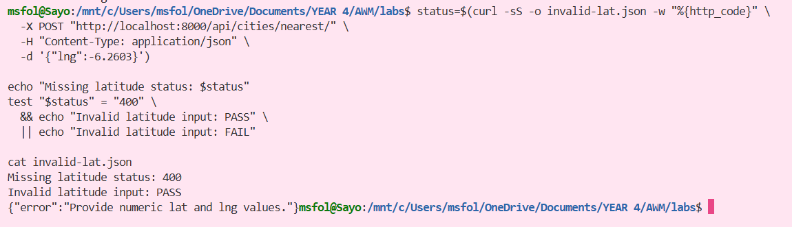

(Invalid Latitute)
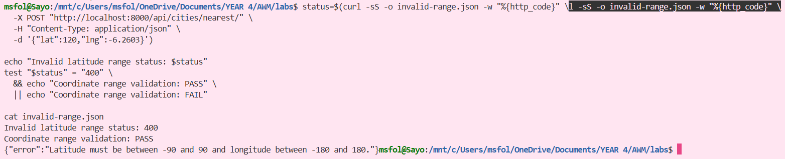

(Invalid Radius)
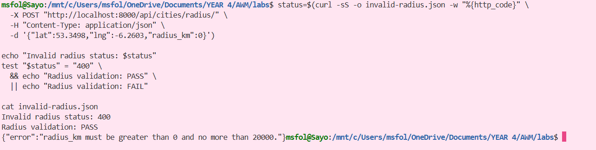

# Task 2:
## 10 Nearest Cities
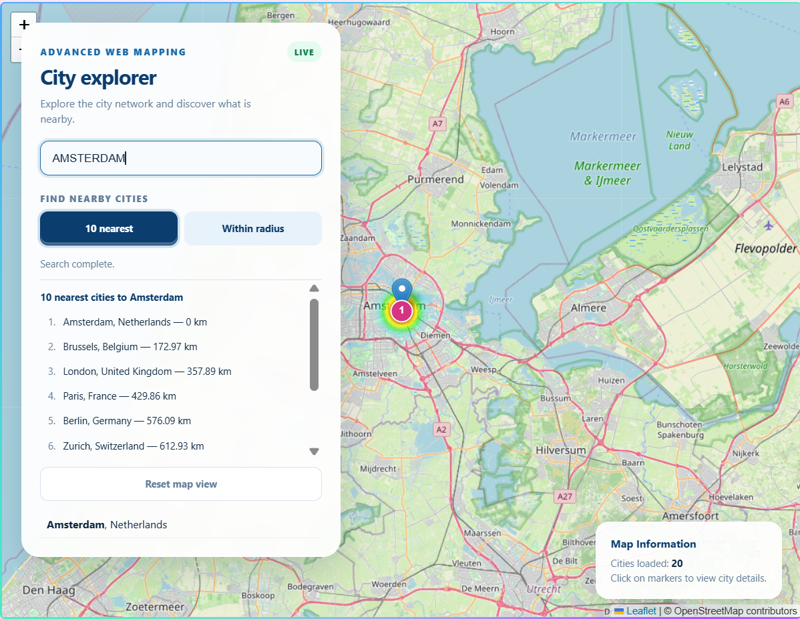

## Within A Radius
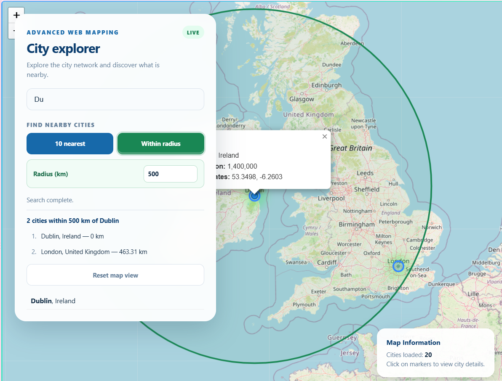

# ORM Query Plan
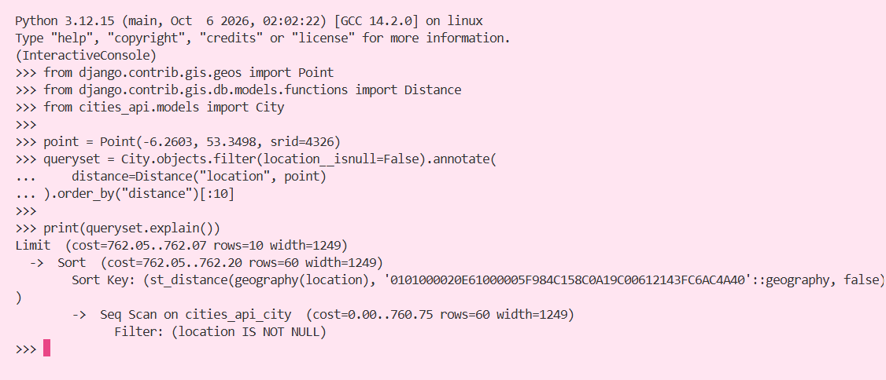

# Test Results
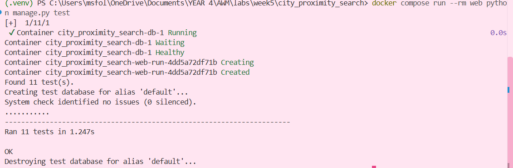