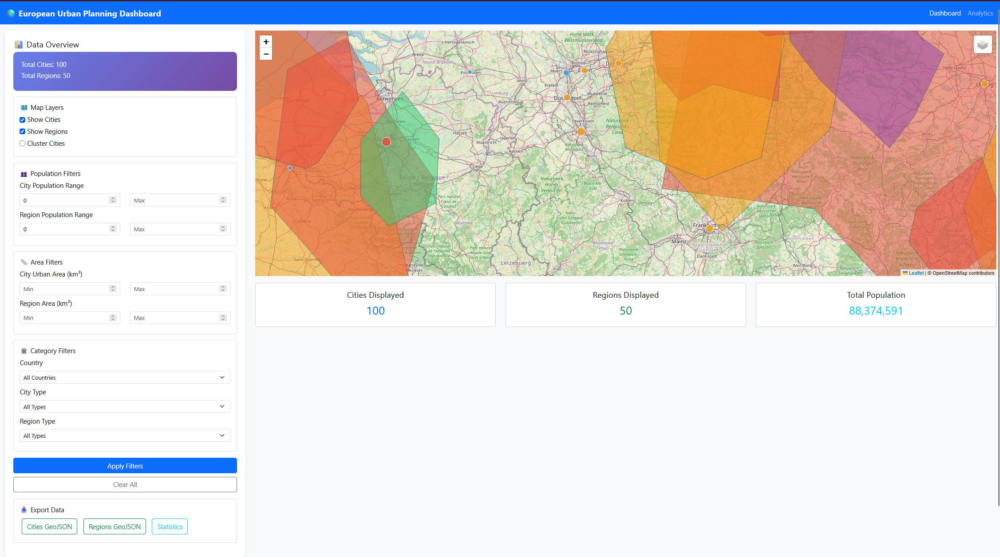
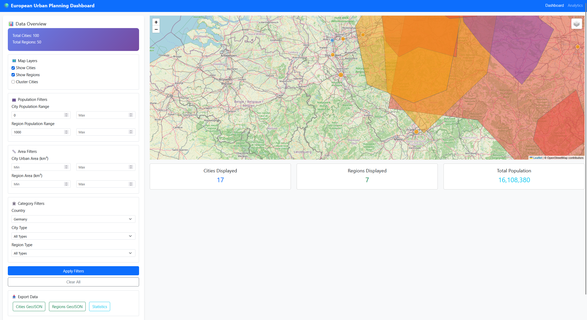
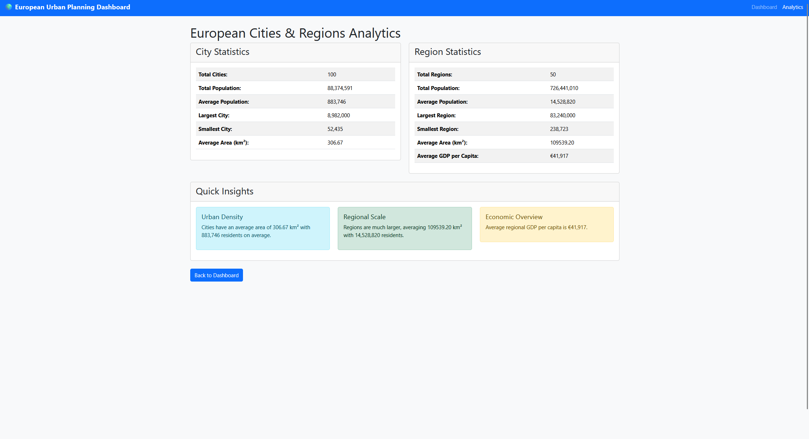
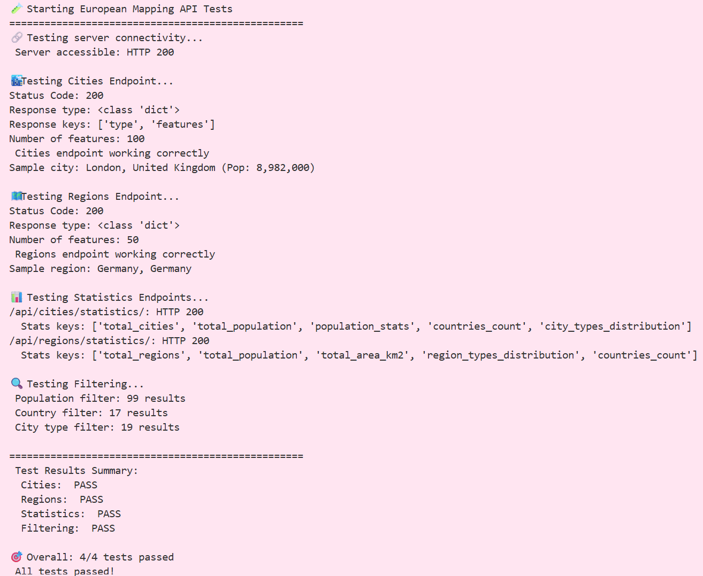

# Week 6 Deliverables: Advanced GeoJSON REST API with Multi-Layer Filtering


# Task 1: API Layers and Filters

## Geometry types
`/api/cities/` returns a `FeatureCollection` of **Point** features (100 cities). `/api/regions/` returns a `FeatureCollection` of **MultiPolygon** features (50 regions).

## Filter counts

| Endpoint / filter | Features returned | Geometry |
|---|---|---|
| `/api/cities/` (no filter) | 100 | Point |
| `/api/cities/?population_min=500000` | 71 | Point |
| `/api/cities/?country=Germany` | 17 | Point |
| `/api/cities/?city_type=capital` | 19 | Point |
| `/api/cities/?urban_area_min=300` | 39 | Point |
| `/api/cities/?country=Germany&city_type=major&population_min=500000` | 14 | Point |
| `/api/regions/` (no filter) | 50 | MultiPolygon |
| `/api/regions/?region_type=state` | 28 | MultiPolygon |
| `/api/regions/?population_min=10000000` | 18 | MultiPolygon |
| `/api/regions/?area_min=10000&country=Germany` | 7 | MultiPolygon |

> Note: 77 of the cities and 47 of the regions are real records. The remaining 23 cities and 3 regions are randomly generated by the populate commands, so reloading the data can change some counts slightly.

## Proximity and bounding box endpoints

| Request | Result |
|---|---|
| `GET /api/cities/nearby/?lat=53.3498&lng=-6.2603&distance=500` (500 km of Dublin) | 12 cities, ordered nearest first: Dublin, Liverpool, Manchester, ... |
| `POST /api/cities/within_bounds/` with `{"west": -11, "south": 50, "east": 2, "north": 59}` | 11 cities (London, Dublin, Birmingham, Leeds, ...) |
| `GET /api/cities/nearby/` (no parameters) | HTTP 400 `{"error": "lat and lng parameters are required"}` |
| `GET /api/cities/nearby/?lat=abc&lng=1` | HTTP 400 `{"error": "Invalid coordinates or distance"}` |
| `POST /api/cities/within_bounds/` with `{"west": 1}` | HTTP 400 `{"error": "Required fields: ['west', 'south', 'east', 'north']"}` |

# Task 2: Dashboard Filtering and Export

## Dashboard with both layers loaded


## Country filter combined with a city population range


## Analytics page


| City statistics | Value | Region statistics | Value |
|---|---|---|---|
| Total Cities | 100 | Total Regions | 50 |
| Total Population | 88,374,591 | Total Population | 726,441,010 |
| Average Population | 883,746 | Average Population | 14,528,820 |
| Largest City | 8,982,000 | Largest Region | 83,240,000 |
| Smallest City | 52,435 | Smallest Region | 238,723 |
| Average Area (km²) | 306.67 | Average Area (km²) | 109,539.20 |
| | | Average GDP per Capita | €41,917 |

# Task 3: PostGIS Verification and Spatial Indexes

## Data in PostGIS
```text
 PostGIS_Version: 3.4 USE_GEOS=1 USE_PROJ=1 USE_STATS=1

 cities | population
--------+------------
    100 |   88374591

 regions
---------
      50

  name  |       st_astext
--------+------------------------
 London | POINT(-0.1278 51.5074)
 Berlin | POINT(13.405 52.52)
 Madrid | POINT(-3.7038 40.4168)

 geometrytype | st_srid
--------------+---------
 MULTIPOLYGON |    4326
```

## Spatial (GiST) indexes
Django created a GiST index automatically for each geometry column:

| Table | Column | Index |
|---|---|---|
| `cities_city` | `location` | `cities_city_location_34cfe5d6_id` (USING gist) |
| `regions_region` | `geometry` | `regions_region_geometry_77791ffd_id` (USING gist) |
| `regions_region` | `centroid` | `regions_region_centroid_ec4d40c4_id` (USING gist) |

The other indexes on these tables are B-tree indexes on `country`, `city_type`, `population`, `area_km2` and similar fields. They come from `Meta.indexes`, `db_index=True`, and the unique constraints.


# Test Results
`docker compose exec web python tests/test_api_endpoints.py`: **4/4 tests passed** (Cities, Regions, Statistics, Filtering).



