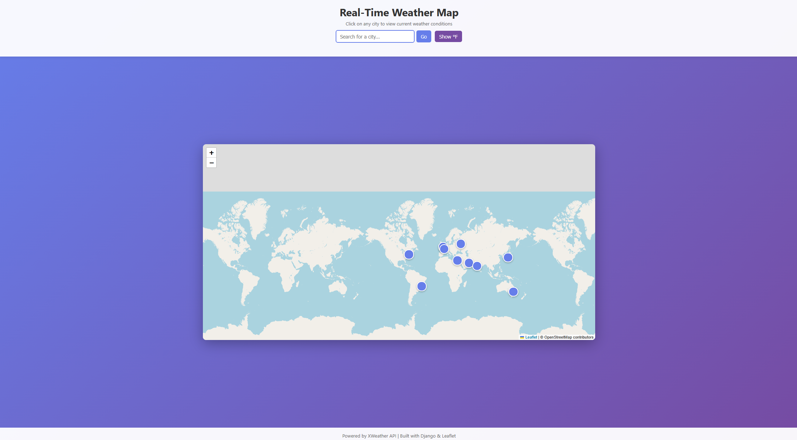

# Week 7: Real Time Weather Map

## Technologies Used

| Layer | Technology |
|---|---|
| Containers | Docker, Docker Compose v2. Services: `web` (Django), `db` (`postgis/postgis:16-3.4`), `pgadmin` (`dpage/pgadmin4:9`) |
| Backend | Python 3.12, Django 5.2, `requests` (outbound HTTP), Django cache framework (`LocMemCache`) |
| Database | PostgreSQL 16 with PostGIS 3.4 (via `django.contrib.gis.db.backends.postgis`) |
| External API | XWeather (`conditions/closest`, `forecasts/closest`), with icons from the XWeather (Aeris) CDN |
| Frontend | Leaflet 1.9.4, OpenStreetMap tiles, vanilla JavaScript (`fetch`, `async/await`, `Promise.allSettled`), CSS Grid, Flexbox and gradients |
| Testing | Django `TestCase`, `unittest.mock` |

## Testing Results 

**Automated tests:** `docker compose run --rm web python manage.py test weathermap`

```text
Found 14 test(s).
..............
Ran 14 tests in 0.378s
OK
```

**Scenarios checked against the running stack:**

| Scenario | Result |
|---|---|
| `manage.py check` | `System check identified no issues (0 silenced).` |
| `/`, `/api/cities/`, `styles.css`, `map.js` | All HTTP 200. 10 cities returned. |
| Credentials empty in `.env` (container recreated) | `/api/weather/1/` → **HTTP 503** `{"error": "XWeather API credentials (XWEATHER_CLIENT_ID and XWEATHER_CLIENT_SECRET) are not configured"}` |
| Invalid credentials (container recreated with fake values) | Weather and forecast → **HTTP 502** `{"error": "XWeather rejected the API credentials"}`. The response contains neither the fake ID nor the fake secret. (XWeather itself answers HTTP 401 `invalid_client`.) |
| Unknown city `/api/weather/9999/` | **HTTP 404** `{"error": "City not found"}` |
| Referrer policy header | `Referrer-Policy: strict-origin-when-cross-origin`, so the OpenStreetMap tiles load |
| PostGIS data | `SELECT COUNT(*) FROM weathermap_city;` → 10 (London, Paris, New York, Tokyo, Sydney, …) |

**Browser checks, done with real credentials:**


