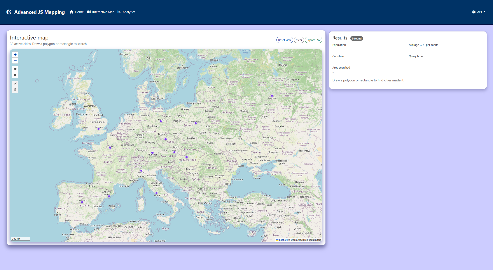
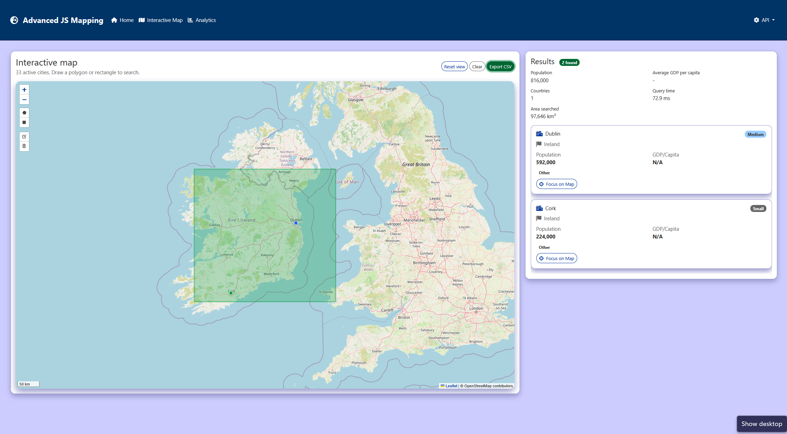
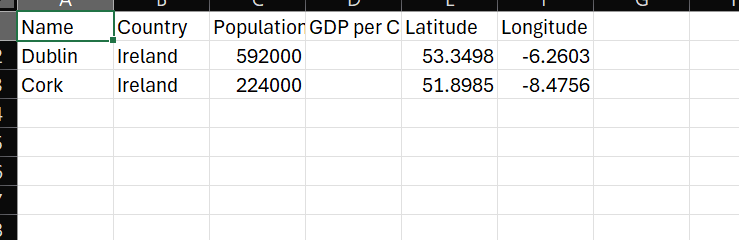

# Lab 9: Advanced JavaScript Mapping

## API

| Endpoint | Method | Purpose |
|---|---|---|
| `/advanced-js-mapping/api/polygon-search/` | POST | Cities strictly inside `{"coordinates": [[lng, lat], ...]}`. The ring is closed automatically. `analysis_type` is optional (`polygon` or `rectangle`). |
| `/advanced-js-mapping/api/cities/` | GET | Paginated city list. Parameters: `page`, `limit` (max 1000), `country`, `type`, `min_population`, `max_population`, `sort`. |
| `/advanced-js-mapping/api/distance-search/` | POST | Cities within `radius_km` (1000 at most) of `latitude`/`longitude`, nearest first, with true distances in km. |

## Results

**Polygon search with the handout's Dublin box** (`[[-7,53],[-5,53],[-5,54],[-7,54],[-7,53]]`):
```text
status: success, cities_found: 1, total_population: 592000, average_gdp: None,
polygon_area_km2: 14770.75, cities: ['Dublin']
```

**Rectangle over Central Europe** (5°E–20°E, 45°N–55°N): 7 cities in 6 countries, total population 12,300,000. In population order: Berlin, Vienna, Budapest, Munich, Prague, Milan, Zurich.

**Distance search, 300 km from Dublin:** Dublin 0.0 km, Belfast 140.39 km, Cork 219.99 km.

**Error handling:**

| Request | Response |
|---|---|
| `GET /api/polygon-search/` (e.g. typed in the address bar) | 405 Method Not Allowed |
| Fewer than 3 points | 400 `INVALID_COORDINATES` |
| Non-numeric or wrong-length coordinates | 400 `INVALID_COORDINATE_FORMAT` |
| Coordinates out of range | 400 `COORDINATE_OUT_OF_BOUNDS` |
| Self-intersecting ("bow-tie") polygon | 400 `INVALID_POLYGON` |
| Malformed JSON | 400 `INVALID_JSON` |

**Database checks (from the lab's Debug Steps):**
```text
SELECT COUNT(*) FROM advanced_js_mapping_advancedcity;            -> 33
SELECT name, country ... WHERE ST_Within(location, 'POLYGON((-7 53,-5 53,-5 54,-7 54,-7 53))')
                                                                  -> Dublin | Ireland
GiST index on location: advanced_js_mapping_advancedcity_location_3ae45e13_id
```

## Tests

**Django:** `docker compose run --rm web python manage.py test advanced_js_mapping --noinput`
```text
Found 15 test(s).
Ran 15 tests in 1.343s
OK
```
The tests cover:
- the search result, ordering and statistics
- that inactive cities, and cities exactly on the boundary, are excluded
- that an unclosed ring is closed automatically
- the equal-area calculation
- analysis and session tracking
- 405 for GET, and 400 for each kind of invalid input
- pagination in the cities API
- distance search, with true distances
- the model's distance helper
- that all three pages render

**JavaScript (Node, no dependencies):** `node advanced_js_mapping/tests_js/loading.test.js`
```text
ok - loading shows during a search and hides after success
ok - a newer search cancels the older one; only the newer result is shown
ok - cancelCurrentRequest (Clear) aborts the search and hides loading
ok - server errors show the server message and hide loading
ok - invalid coordinates are rejected before any request
ok - zero population is kept, missing values become null
6/6 tests passed
```

## Screenshots



City Search:


Exported CSV:


Analytics:
